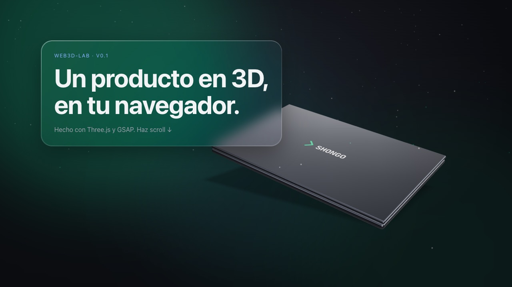
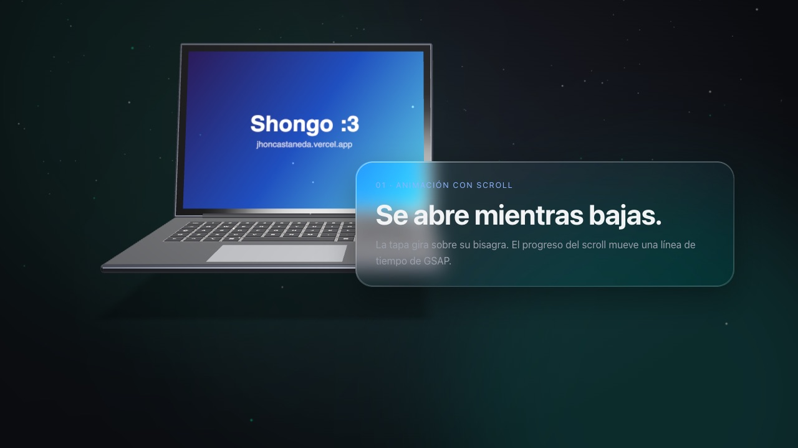
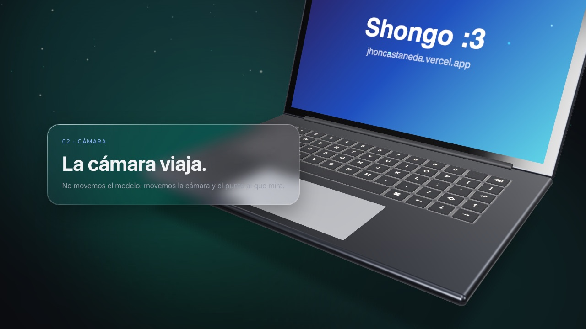
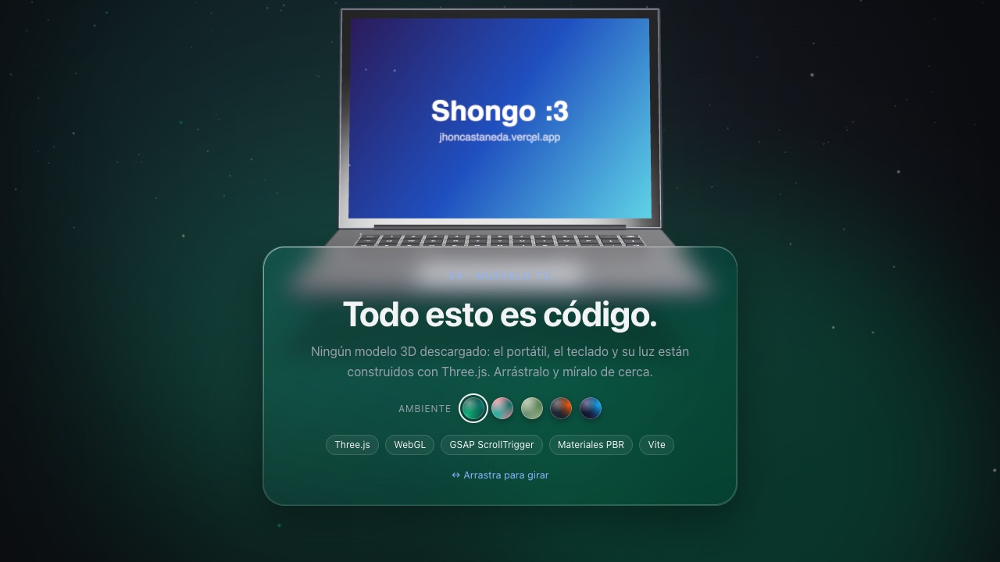
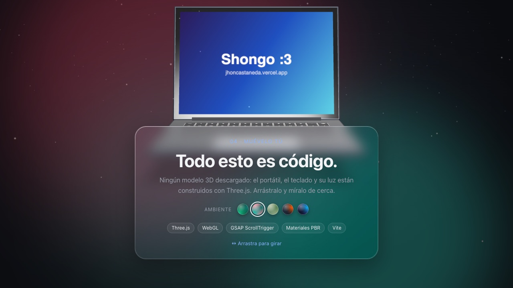
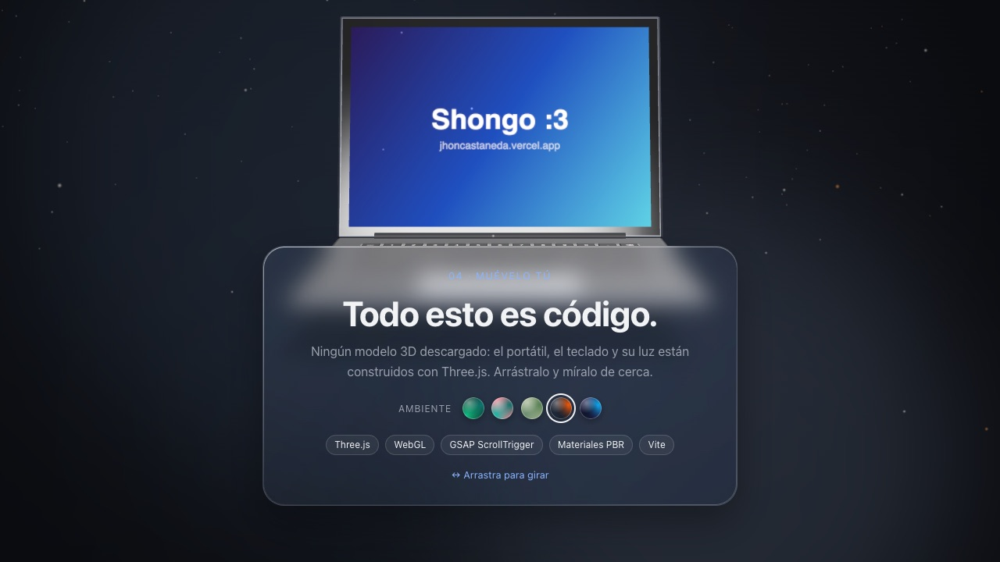
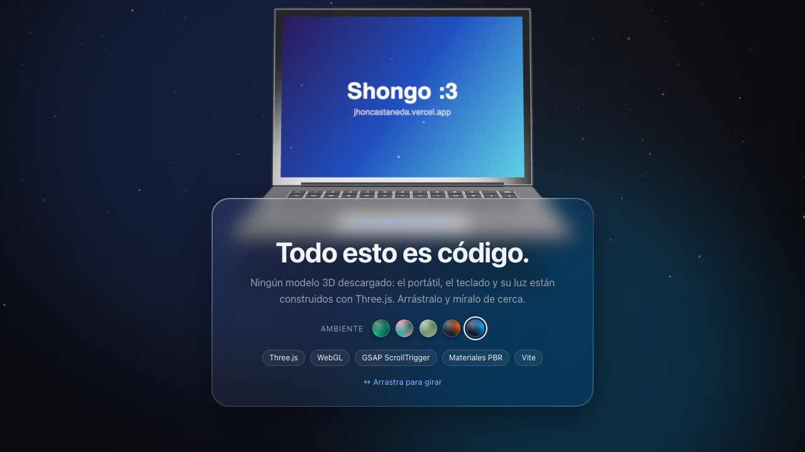

# web3d-lab

Un portátil 3D construido 100 % con código que se abre, se ilumina y gira con el scroll. Hecho con **Three.js + GSAP + Vite**.

**🔗 Ver en vivo: [jhonedinson-shongo.github.io/web3d-lab](https://jhonedinson-shongo.github.io/web3d-lab/)**

[](https://github.com/JhonEdinson-Shongo/web3d-lab/actions/workflows/deploy.yml)


[](https://jhonedinson-shongo.github.io/web3d-lab/)

## El recorrido

| Se abre mientras bajas | La cámara viaja hasta el teclado |
|---|---|
|  |  |

Al final puedes **arrastrar el portátil para girarlo** y elegir el **ambiente** del fondo:

| Shongo sobrio | Turquesa y coral |
|---|---|
|  |  |
| **Carbón y brasa** | **Abismo** |
|  |  |

### Qué tiene

- **Sin modelos descargados:** base, teclado (una sola `InstancedMesh`), bisagra, tapa y pantalla son geometría hecha con código.
- **Animación con scroll:** una línea de tiempo de GSAP con `scrub` abre la tapa, enciende la pantalla y mueve la cámara.
- **Materiales PBR:** aluminio metálico que refleja un entorno de luz; el color se cambia en vivo.
- **Teclado retroiluminado** tipo MacBook: luz que se escapa por las rendijas y letras iluminadas.
- **Logo en la tapa** que siempre se lee derecho, con la tapa cerrada o abierta.
- **Fondo dinámico:** aurora de color por sección + partículas de luz que aceleran con el scroll.
- **Tarjetas de vidrio** estilo iOS (`backdrop-filter`).
- **Arrastrar para girar** con inercia, también en pantallas táctiles.

## Arrancar

```bash
npm install     # solo la primera vez
npm run dev     # abre la URL que aparece (normalmente http://localhost:5173)
```

Cada vez que guardas un archivo, el navegador se actualiza solo.

## Estructura

| Archivo | Qué hace |
|---|---|
| `index.html` | Los textos y los metadatos SEO. Cada `<section class="panel">` es una "pantalla" del scroll. |
| `src/style.css` | El diseño: tarjetas de vidrio, aurora, selectores y el canvas fijo de fondo. |
| `src/laptop.js` | El portátil, construido con código: cajas redondeadas, teclas, retroiluminación, logo y la tapa con su bisagra. |
| `src/background.js` | El fondo dinámico: la aurora y las partículas. |
| `src/palettes.js` | Las paletas de "Ambiente". La primera es la que se ve al entrar. |
| `src/main.js` | Escena, cámara, luces, la animación con scroll (GSAP), los selectores y el arrastre. |
| `public/` | Archivos que se copian tal cual: logo, favicon, íconos, imagen para redes y `sitemap.xml`. |

## Conceptos clave (en `src/main.js`)

1. **Renderer + escena + cámara**: la base de cualquier proyecto Three.js.
2. **`scene.environment`**: un entorno de luz que se refleja en los metales. Sin esto, el aluminio se ve negro.
3. **Jerarquía de grupos**: `parallax > model > spin > laptop`. Cada nivel se anima por separado (ratón, scroll, arrastre) sin pisarse con los demás.
4. **Línea de tiempo con `scrub`**: el progreso del scroll (de 0 a 1) "reproduce" la animación. Cada `.to(..., N)` empieza en la sección N.
5. **Loop de render**: corre unas 60 veces por segundo. Aquí van la flotación, el parallax del ratón, la inercia del arrastre, las partículas y la cámara.

## Ejercicios (de fácil a difícil)

1. Cambia el texto y los colores de la pantalla en `createScreenTexture()`.
2. Agrega un quinto color al selector.
3. Crea tu propio ambiente en `src/palettes.js`.
4. Haz que la tapa se abra más (`OPEN_ANGLE`) o que el modelo dé dos vueltas al final.
5. Agrega una nueva sección en `index.html` y su paso en la línea de tiempo.
6. Pon un video como pantalla: busca `THREE.VideoTexture`.
7. Agrega **Lenis** (`npm i lenis`) para que el scroll sea suave.
8. **El gran salto:** reemplaza el portátil por un modelo tuyo hecho en Blender (ver abajo).

## Usar un modelo .glb (de Blender o Sketchfab)

1. En Blender: `File → Export → glTF 2.0`, formato **glb**.
2. Guárdalo en `public/models/mi-modelo.glb`.
3. En `src/main.js`:

```js
import { GLTFLoader } from 'three/addons/loaders/GLTFLoader.js';

new GLTFLoader().load(`${import.meta.env.BASE_URL}models/mi-modelo.glb`, (gltf) => {
  spin.remove(laptop.group);
  spin.add(gltf.scene);
  // Para animar una parte (por ejemplo la tapa), búscala por el nombre que le diste en Blender:
  // const lid = gltf.scene.getObjectByName('Tapa');
});
```

Tip: en Blender, pon el *origen* de la tapa en la bisagra. Así, rotarla en Three.js la abre correctamente.

Para revisar y comprimir modelos usa https://gltf.report. Si el modelo es de Sketchfab, **revisa su licencia** antes de usarlo en un proyecto real.

## Publicar

Cada push a `main` (incluidos los merges de pull requests) compila el proyecto y lo publica en GitHub Pages con el workflow `.github/workflows/deploy.yml`.

- En GitHub, **Settings → Pages → Source** debe estar en **"GitHub Actions"**.
- El build usa `base: '/web3d-lab/'` (`vite.config.js`). Para cargar archivos de `public/` desde JavaScript usa `import.meta.env.BASE_URL`, no rutas que empiecen por `/`.

Para probar el build en local:

```bash
npm run build     # genera dist/
npm run preview   # lo sirve en http://localhost:4173/web3d-lab/
```

### SEO

- Título, descripción, URL canónica, Open Graph y Twitter Card en `index.html`, con datos estructurados (JSON-LD) del autor.
- `public/og-image.png` (1200×630) es la vista previa al compartir el enlace.
- `public/sitemap.xml`: envíalo en [Google Search Console](https://search.google.com/search-console) para acelerar la indexación.

---

Hecho por [Jhon Castañeda](https://jhoncastaneda.vercel.app/).
